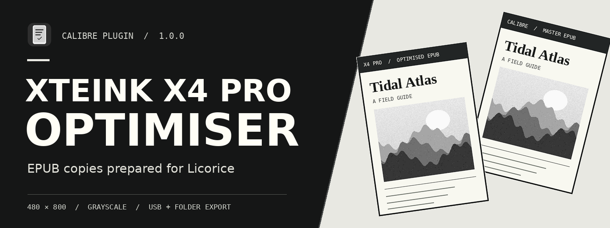
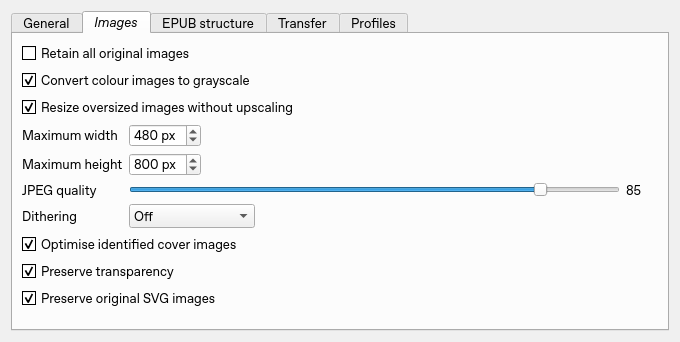

# XTEINK X4 Pro Optimiser

**Version 1.0.0** · **Calibre 9.19 or later** · **XTEINK X4 Pro with XT Licorice**

[Download a tested build from GitHub Actions](https://github.com/tubbygregory/XTEINK-X4-Pro-Optimiser/actions)

Prepare EPUB copies for the X4 Pro from the Calibre library you already use. The plugin reads the EPUB in your library, creates a separate optimised copy and exports it to a folder or a confirmed USB destination. The original stays byte-for-byte intact and is available as usual for your Kobo or another reader.

## Main highlights

- **Images sized for the X4 Pro.** Balanced uses the 480 × 800 portrait display, grayscale and JPEG quality 85. It keeps the aspect ratio and skips upscaling.
- **Your book’s formatting travels with it.** The default keeps EPUB 2 and 3 metadata, covers, chapter and footnote links, CSS, fonts and SVG artwork. Optional chapter splitting and cleanup use Calibre’s Edit Book tools.
- **One book or the whole library.** Batches run in the background with cancellation and a summary. A content-addressed cache reuses finished copies when the source and effective settings match.
- **USB, a local folder or Wi-Fi.** Copy straight to a confirmed SD card folder, export for later, or send the exported copies using Licorice’s Calibre Transfer or OPDS screen.

## Get started

1. Download **XTEINK-X4-Pro-Optimiser-1.0.0.zip** from the **Artifacts** section of a successful build. Leave the plugin ZIP intact.
2. In Calibre, open **Preferences → Plugins → Load plugin from file**, select the ZIP and restart Calibre.
3. Add **XTEINK X4 Pro Optimiser** under **Preferences → Toolbars & menus** if Calibre does not place it on the main toolbar. Calibre lets you add it to the library context menu as well.
4. Open **Settings** from the action’s dropdown or use **Preferences → Plugins → User interface action → XTEINK X4 Pro Optimiser → Customize plugin**. Choose an export folder outside the Calibre library. **Balanced** is a good starting point.
5. Select books with EPUB formats and click **Optimise for XTEINK X4 Pro**. Open **Details** in the completion dialog for size changes, cache hits, skipped books and errors. Use **Optimise entire library** in the dropdown to include books hidden by a search or filter.

## Transfer to the reader

### USB mode

1. Connect the X4 Pro with a data-capable USB connection and enable **USB Mode** on the reader. On newer Licorice builds, look on the **Transfer** page.
2. In Windows 11, open File Explorer to find the mounted SD card. Pick an existing directory for your books or create one on the card, for example §Books§. You can set this folder under **Settings → Transfer**. If the drive letter changes, select the new path.
3. Select books in Calibre and choose **Send Optimised to XTEINK**. The plugin asks you to select and confirm the destination before it writes. A single mounted volume labelled §XTEINK§ or §X4 Pro§ can be suggested. Check the drive and folder yourself.
4. Wait for the export summary, then eject the card or device in your operating system and leave USB mode. Find the copied EPUBs under **Files** or **All Files** on the reader.

**Send to XTEINK (USB)** follows the **Automatically optimise EPUBs when sending to XTEINK** setting. With it off, that action copies the original EPUB bytes to the confirmed USB folder. **Send Optimised to XTEINK** always applies the active profile. Calibre’s regular **Send to device** continues to use Calibre’s selected device driver. [XTEINK USB instructions](https://www.xteink.com/blogs/product/x4-pro-faq-specs-support)

You can also export to a local folder and copy the EPUBs to a card with File Explorer. Choose flat, first-author or series folders. The filename template accepts §{title}§, §{authors}§, §{series}§ and §{id}§. Identical copies are recognised before applying the **Keep both**, **Skip existing file** or **Replace existing file** setting.

### Wi-Fi with Calibre Transfer or OPDS

Export the optimised EPUBs first. If you want to serve them using Calibre, create a small **separate** library named *XTEINK Exports* and add the exported files there. For updates, replace the EPUB format in that staging library with the new export. Keep using your main library as the source for optimisation.

- **Calibre Transfer.** On the same network, select the staging library and choose **Connect/share → Start wireless device connection** in Calibre. Open **Calibre Transfer** on Licorice and connect it to Calibre. Send the EPUBs from the staging library once Calibre identifies the connected reader. Licorice builds with this feature have been observed saving them under §/Downloads/Calibre§. [Stock-firmware walkthrough](https://ocdevel.com/blog/20261013-ereader-opds-rss-calibre-koreader) · [Licorice 26112001 release notes](https://www.reddit.com/r/xteinkereader/comments/1y0yw1j/x4_pro_licorice_v26112001_release_note/)
- **OPDS.** Run Calibre’s Content server against the staging library or start §calibre-server "C:\path\to\XTEINK Exports"§. On the reader, open **OPDS → Add catalog**, enter a URL such as §http://192.168.1.20:8080/opds§ using your computer’s address, tap **Test**, then save and download the EPUBs. Use a trusted local network and follow your server’s authentication settings. [Calibre Content server](https://manual.calibre-ebook.com/server.html) · [Licorice OPDS update notes](https://www.reddit.com/r/xteinkereader/comments/1x5um2x/x4_pro_update_xt_licorice_261014/)

## Settings and presets

| Profile | Image settings | When to use it |
| --- | --- | --- |
| **Balanced** | Grayscale, JPEG quality 85, 480 × 800 maximum | Most EPUBs |
| **Maximum Compression** | Grayscale, JPEG quality 65, 384 × 640 maximum | Image-heavy books where smaller copies matter |
| **Maximum Quality** | Original image bytes, fonts and styling | Detailed illustrations, maps or comics |
| **Custom** | The image and EPUB settings as you last edited them | A book that needs a different profile |

- **Images.** You can change the pixel limits, turn grayscale off, choose JPEG quality from 1–100, and leave the identified cover untouched. Lower JPEG quality targets smaller files. The plugin can reuse already compliant JPEGs. It applies EXIF rotation before resizing and drops ancillary metadata on rewritten images while retaining compatible colour profiles.
- **Dithering.** Off gives the reader a grayscale image. Floyd–Steinberg diffuses error into neighbouring pixels, while Ordered uses a repeating pattern. Both create a black-and-white pattern in the image. Compare them with Off using a photo or illustration on your reader.
- **Transparency and vectors.** By default PNG and static GIF transparency are retained. If you turn transparency preservation off, eligible images are composited on white. Animated images are kept whole. SVGs stay vector. Disabling **Preserve original SVG images** allows XML comment removal from eligible SVG files.
- **EPUB structure.** To opt in to font removal or Calibre’s unused CSS cleanup, turn off **Preserve original styling and embedded fonts**. Keep fonts for books that depend on specialised glyphs. Large chapters can be split at body-level blocks. Splitting can change styles that depend on a chapter’s element positions. Unused resource removal targets unreferenced raster images when the publication’s media permits a reliable check.
- **Validation and fixes.** Built-in checks cover the ZIP container, OPF manifest and spine, navigation and local markup links. Enable **Run EPUBCheck when available** for the full validator. Supply its executable or §epubcheck.jar§ path. The JAR requires Java. Compatibility fixes repair misplaced or compressed EPUB mimetype entries and encode progressive JPEGs as baseline when image optimisation is active. [EPUBCheck](https://github.com/w3c/epubcheck)
- **Profiles.** Open **Profiles → Save as** to name a copy of your current settings. To update a named profile, select it, edit the values and save under the same name. Export the active preset to JSON and import presets on another computer. Storage paths and transfer settings are local to each Calibre installation.

## Troubleshooting and limits

| Symptom | What to check |
| --- | --- |
| **No USB drive appears** | Switch the reader to USB Mode, try a data-capable cable and check File Explorer. Folder export also works with a separately mounted microSD card. |
| **The drive letter changed or a transfer failed** | Reconnect and confirm the folder again. A completed EPUB is published atomically where the filesystem supports it. If a disconnection strands a §.xteink-*.part§ file on the card, you can remove that temporary file after reconnecting. |
| **A book is skipped or fails validation** | Open the batch details. A book needs an EPUB format in the library. The optimiser reports malformed archives, encrypted and font-obfuscated EPUBs, signed EPUBs and multi-rendition packages. Individual errors leave the rest of the batch running. |
| **A book looks wrong on the reader** | Try **Maximum Quality** or keep the original images and embedded fonts. A valid EPUB can still use formatting a particular Licorice build renders differently. Compare the result with the original book. |
| **An advanced edit was skipped** | The plugin preserves the structure of books with scripting, fixed layout, media overlays, external resources, fallback resources, base URLs or CFI links. One long paragraph or table may be too large to split safely. |
| **The exported size did not shrink** | Text-only books and images already at target often need no changes. Resizing, grayscale and preserving transparency can sometimes improve display or compatibility while producing a larger file. |
| **The cache is large** | Use **Clear optimisation cache** from the plugin dropdown. Changes to the source bytes, optimisation settings or engine version automatically create a new cache entry. |
| **You need details from a failed batch** | Enable **Write a diagnostic log**. The summary shows the log location under Calibre’s configuration directory at §plugins/xteink_x4_pro/optimiser.log§. It includes book titles and paths. |

The optimiser runs locally and handles one book at a time. Limits include a 768 MiB compressed archive, 1 GiB total expanded size, 128 MiB per entry, 24 MiB per XML file and 32 million pixels per decoded image. Excessive compression ratios and ambiguous or unsafe ZIP paths are refused. The plugin stages working files outside the library and discards them as each book finishes. Copies in the optional disk cache are separate from exports.

## Calibre version and firmware scope

The plugin targets **Windows 11** and loads on **Windows, Linux and macOS** with Calibre 9.19 or later. Automated tests use the official Calibre 9.19.0 Windows and Linux runtimes. The hardware target is the **X4 Pro on XT Licorice**. Physical USB detection, card behaviour, EPUB rendering and wireless interoperability still need testing on an X4 Pro. [XTEINK product specification](https://www.xteink.com/products/xteink-x4-pro-pocket-ereader) · [TuyaOpen X4 Pro board specification](https://github.com/tuya/TuyaOpen/blob/master/boards/ESP32/XTEINK_X4_PRO/board_config.h)

Calibre’s **Polish Books** action applies a set of edits to book formats in the library. The XTEINK action prepares separate EPUB copies with a display-specific image profile, a cache and confirmed destinations. Both actions can be installed alongside KoboTouch, KoboTouchExtended and Calibre’s standard conversion system. [Calibre Polish Books documentation](https://manual.calibre-ebook.com/generated/en/ebook-polish.html)

## Development

§§§sh
python -m pip install -r requirements-dev.txt
PYTHONPATH=plugin python -m unittest discover -s tests -v
python scripts/build.py
§§§

PowerShell users can set §$env:PYTHONPATH = 'plugin'§ before running the test command. To exercise EPUBCheck, set §XTEINK_TEST_EPUBCHECK§ to its absolute executable or JAR path.

Install the candidate ZIP into an isolated Calibre configuration and run the same suite and integration checks using Calibre’s bundled Python and Qt.

§§§sh
export CALIBRE_CONFIG_DIRECTORY="$(mktemp -d)"
export QT_QPA_PLATFORM=offscreen
calibre-customize --add-plugin dist/XTEINK-X4-Pro-Optimiser-1.0.0.zip
calibre-debug --exec-file tests/calibre_suite.py
calibre-debug --exec-file tests/calibre_smoke.py
§§§

The reusable engine is in §plugin/xteink/§. It uses Pillow and lxml, both bundled with the tested Calibre runtime. The Calibre action, settings and optional structure editor are at the root of §plugin/§. Tests generate synthetic EPUBs with known resources. §.github/workflows/build.yml§ uploads the installable ZIP after the Linux and Windows jobs pass.

## Research and credits

- KoboTouchExtended’s device entry point and upload path informed the device-specific workflow. CrossPoint’s Calibre driver and optimizer were reviewed for architecture and trade-offs. CrossPoint’s WebSocket uploader is firmware-specific. This plugin’s implementation is original. [KoboTouchExtended device source](https://github.com/jgoguen/calibre-kobo-driver/tree/1a222ca/device) · [CrossPoint driver and optimizer source](https://github.com/crosspoint-reader/calibre-plugins/tree/54f73d7/crosspoint_reader)
- EPUB Optimizer moves image processing and recompression into the browser using MozJPEG and JavaScript. This project uses Calibre’s bundled Pillow for native, local processing and retains EPUB resource formats to minimise markup changes. [EPUB Optimizer](https://epubdev.pages.dev/) · [Calibre plugin developer documentation](https://manual.calibre-ebook.com/plugins.html)
- XTEINK distributes Licorice through XT Cloud and on-device updates. Public materials reviewed include the vendor’s announcement and update notes, the X4 Pro USB instructions and independently observed OPDS and Calibre Transfer workflows. A public Licorice firmware source repository could not be located. The study did not establish a general-purpose Licorice upload API or a stable identifier that Calibre can use to distinguish a Licorice-connected X4 Pro from every other wireless device. [XT Licorice announcement](https://www.reddit.com/r/xteinkereader/comments/1wiu4dq/meet_xt_licorice_new_official_firmware_for_x4_pro/) · [XT Cloud](https://xtcloud.xteink.cc/app)
- The README’s monochrome artwork and release highlights were inspired by the CrossNext 2.0.6 announcement. The header illustration and Calibre screenshot were made for this project. [CrossNext release post](https://www.reddit.com/r/XTEINK/comments/1y1b5i0/release_crossnext_206_for_xteink_x4_pro_new_epub/)

Maintained by Gregory Tubby. Licensed under GPL-3.0-or-later. [Licence](LICENSE)
